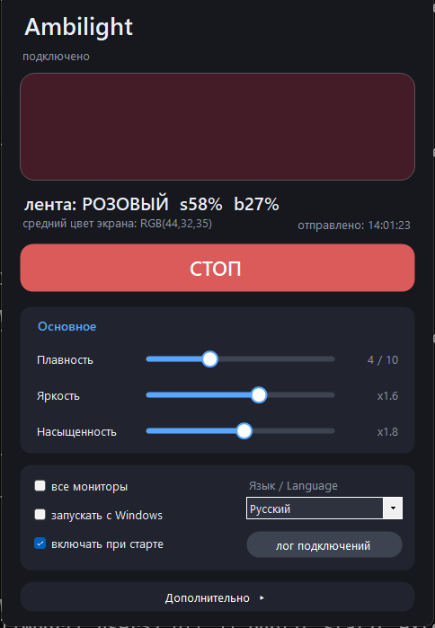

# IOTBT701 BLE LED Strip — Windows Control & Ambilight

> 🌐 Documentation language: **English** | [Русский](README.ru.md) | [Español](README.es.md) | [中文](README.zh-CN.md) | [Português](README.pt-BR.md)

Reverse-engineered control of a **Zengge / IOTBT-family Bluetooth (BLE) LED strip**
("IOTBT701", MAC `08:65:F0:DE:37:01`) from a Windows 10/11 PC — with **no vendor app,
 no pairing, no serial numbers, no cloud**. Includes a ready-screen->strip **Ambilight**
program with a settings GUI.

Everything here was **verified against the physical device** 2026-10-30/31. Protocol
knowledge is derived from the open-source [8none1/lednetwf_ble](https://github.com/8none1/lednetwf_ble)
Home Assistant integration plus our own captures on this specific unit.

## What works (verified matrix)

| Capability | Status | Transport |
|---|---|---|
| BLE discovery (`IOTBT701` advertised) | ✅ verified | BLE adv, RSSI -56..-86 dBm |
| GATT connect + keepalive (`GattSession.MaintainConnection`) | ✅ verified | service `FFFF` |
| Command write (write-without-response) | ✅ verified | char `FF01` |
| Power ON / OFF | ✅ verified | `3B 23 / 3B 24` payload |
| Solid white (saturation 0) | ✅ verified | v3 colour + legacy `3B A1` |
| Colour (hue 0..359, 12-colour sweep + long use) | ✅ verified | **`E0 01 00 A1` (colour_data_v3)** |
| RGB → HSV conversion | ✅ verified | C# helpers in this repo |
| Ambilight (screen average → strip, GUI, settings) | ✅ verified | `AmbilightOT.exe` |
| Startup integration + failure logging (v1.5) | ✅ verified | startup checkbox + `ambilight_log.txt` + auto "LINK LOST" window |
| Readable link-drop diagnostics (v1.8) | ✅ verified | log shows real error type + HRESULT, device/GATT status events and a link-state snapshot on every `LINK LOST`; no more double worker on quick Stop/Start |
| Notify/state readback (FF02) | ✅ verified (query `81 8A 8B 40` in family `0x0A`; status frame `EA 81 … F0 <hue> <sat> <bri>`; registers mirror the *vendor app* state only) | char `FF02` |
| Brightness scale | ✅ verified: byte = **percent 0..100**; values >100 corrupt colour | v3 brightness byte |

**Key non-obvious finding:** this device **ignores every classic colour command**
(`31/41/42/46 R G B ...`, and `3B A1 <hue> <sat> <bri>` whenever hue ≠ 0).
Only the **v3 envelope `E0 01 00 A1 ...`** drives colour ("the E0 01 envelope is
load-bearing", same conclusion as PR #101 of lednetwf_ble).

**Key device-specific finding:** with full saturation the packed hue byte-pair is
`<hue/2> <sat>` only for **even hue degrees**. The odd-hue encoding (`lo = sat + 128`)
is **misinterpreted by this firmware** (azure 193° produced a wrong/inert result).
Fix used here: quantize hue to the nearest **even** degree (≤1° error, invisible).

## Repo layout

```
README.md            this file
docs/PROTOCOL.md     byte-exact protocol: framing, checksum, commands, quirks
docs/AMBILIGHT.md    how the screen-colour extraction works, every constant
docs/BUILDING.md     how the .exe files are built (no Visual Studio, C# 5 compiler)
docs/reports/        analytical project reports as PDF ×5 (EN/RU/ES/ZH-CN/PT-BR)
src/                 sources: AmbilightOT GUI, ledctl console tool, BLE scanner,
                     build scripts
```

## Screenshots



*The window in action: live colour swatch (the exact colour the strip renders),
screen-average readout, status + log, and all settings. UI language switcher in
the Settings box: Русский / English / Español / 中文 / Português (BR).*

## Tools

| Program | Purpose |
|---|---|
| `AmbilightOT.exe` | Ambilight: screens the primary monitor ~1.4×/s, computes the dominant colour, drives the strip. WinForms GUI with live colour preview and settings (UI languages: RU/EN/ES/ZH-CN/PT-BR, switchable in the window). Shortcut-friendly (close window = strip keeps colour, remote control resumes). **v1.5:** "run at Windows startup" checkbox (shell:startup shortcut), ms-precise `ambilight_log.txt` with 512 KB rotation, "connection log" button, and an auto-popup full-log window **LINK LOST** when the strip drops on its own. **v1.6:** smooth colour fade — writes glide toward the target in steps (setting 1–6 frames, 1 = the old snap). **v1.7:** time-based HSV glide on a separate capture thread (smoothness 1–10, 1 = snap, each step adds 0.25 s), continuous white/colour blend, even-hue quantisation. **New dark UI:** rounded cards, big live colour preview, one start/stop button, sliders for smoothness/brightness/saturation, collapsible *Advanced* section |
| `ledctl.exe` | Console tester: `on`, `off`, `white`, `rgb R G B`, `hsv H S B`, 12-colour sweep (brightness clamped to the verified 0–100 % scale) |
| `lednotify.exe` | FF02 state feedback: `query` asks the strip for its status frame, `ladder`/`l0a` run brightness experiments with readback, `listen` watches remote/app events |
| `blescan.exe` | 25 s BLE advertisement scanner |

## Safety / etiquette notes

- BLE write rate: **verified up to ~17 commands/s sustained** (3.5-min soak: 3600/3600 delivered,
  link stable, no backlog); bursts of even 456/s queued fine. Old "2.5/s"advices were over-caution.
- The vendor phone app (Surplife/Zengge) must be closed while the PC tool holds the link;
  the strip accepts **one** GATT client.
- Closing the control program leaves the last colour on the strip and returns the
  remote control; nothing is persisted beyond the usual device behaviour.
